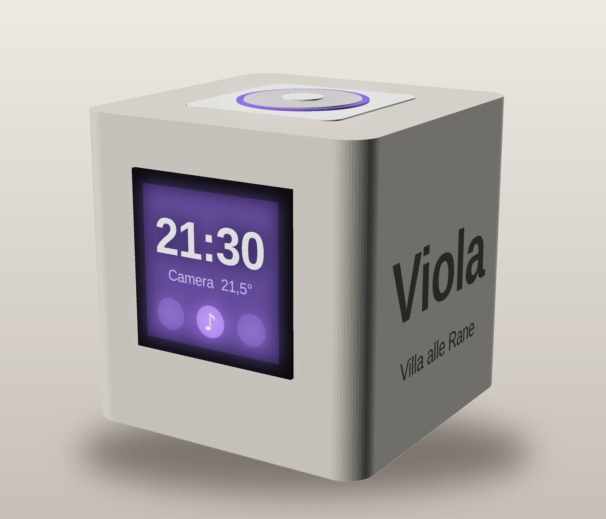
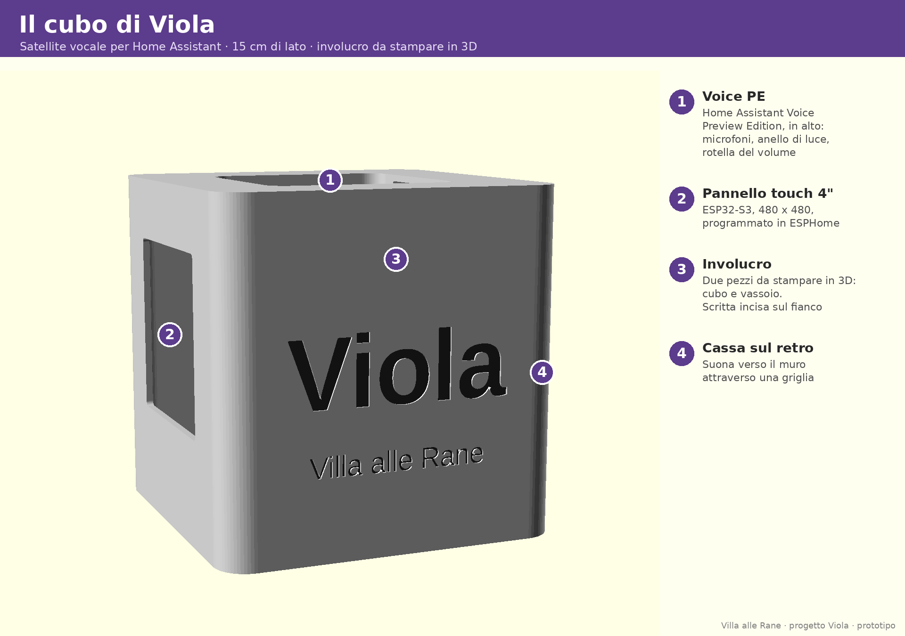
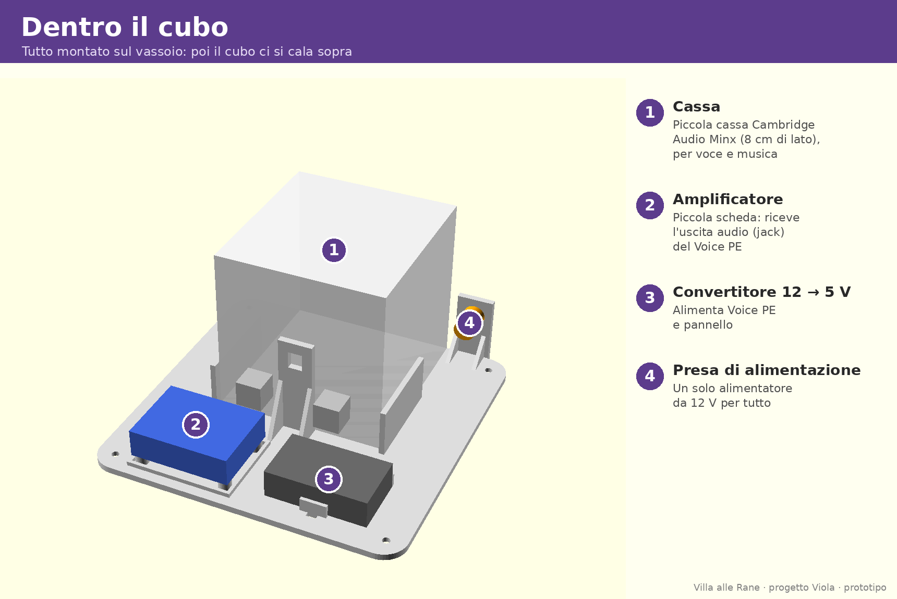

# Il cubo di Viola

Un satellite vocale da comodino per Home Assistant: Voice PE per ascoltare e parlare, un pannello touch da 4" in ESPHome, una cassa vera per la musica, in un cubo da 15 cm da stampare in 3D.



**Stato: prototipo.** Elettronica e firmware girano sul banco. L'involucro è alla versione 3 ed è in stampa per la prima volta: le misure sono verificate solo al computer, nessun pezzo è ancora stato montato. L'immagine qui sopra è un rendering.

## Perché
In casa abbiamo un Echo per stanza, ma il nostro assistente è un altro: Viola, costruita dentro Home Assistant con un modello di linguaggio (Claude, tramite l'integrazione Anthropic di HA). Con lei si conversa: conosce la casa, ha una sua memoria, cerca sul web, porta messaggi fra le stanze. Dentro un Echo non ci entra. Il cubo è il modo per averla in ogni camera.

Questo repository contiene **il cubo** (involucro, elenco dei pezzi, firmware del pannello). La parte «Viola» dentro Home Assistant (prompt, memoria, corsia veloce per i comandi semplici) non è qui.

## Cosa c'è dentro
| Cartella | Contenuto |
|---|---|
| `3d/` | Sorgente OpenSCAD (`cubo.scad`), lo stesso pezzo in CadQuery per avere gli STEP (`cubo_step.py`), i file STEP e STL di cubo, cubo con scritta incisa e vassoio |
| `firmware-pannello/` | Configurazione ESPHome del pannello touch (`cubo-pannello.yaml`) |
| `immagini/` | Viste con le etichette |




## Hardware
| Pezzo | Cosa usiamo | Note |
|---|---|---|
| Satellite vocale | Home Assistant Voice Preview Edition, nella sua scocca (83 x 83 x 20 mm) | incassato a filo nel coperchio; spine USB-C e jack ad angolo retto |
| Pannello | Waveshare ESP32-S3-Touch-LCD-4, 480 x 480 (vetro 84 mm, scheda 75 mm) | foro da 77 mm, incollato da fuori |
| Cassa | Cambridge Audio Minx (78 x 78 x 83 mm) | sul retro, suona verso il muro attraverso la griglia; fermata da una staffa sulla sua vite posteriore |
| Amplificatore | schedina da 46 x 35 mm, fori M2 a 40 x 28 | riceve il jack del Voice PE |
| Alimentazione | alimentatore 12 V, presa da pannello diametro 10 mm, convertitore 12 → 5 V (46 x 27 x 13 mm) | 12 V all'ampli, 5 V a Voice PE e pannello |
| Filtro di massa audio | isolatore da 3,5 mm | sciolto dentro il cubo; toglie il ronzio fra PE e ampli |

Tutto si monta sul vassoio; poi il cubo, con pannello e Voice PE, ci si cala sopra e si chiude con 4 viti M3 in inserti a caldo.

## Il pannello
Il pannello non conosce le entità di Home Assistant. HA gli parla con poche azioni (`pannello_messaggio`, `pannello_risposta`, `pannello_squilla`, `pannello_in_chiamata`, `pannello_sveglia`, `pannello_chiudi`) e lui risponde con un solo evento (`esphome.banco_pannello`, con il campo `azione`). La logica resta in HA.

Funzioni: orologio con nome della stanza e temperature · non disturbare · oscuramento notturno a orari · messaggi fra stanze con conferma di lettura · chiamate fra stanze · pagina musica con copertina (Music Assistant) · timer del Voice PE · sveglia · menu impostazioni con pressione lunga.

**Prima di usarlo in casa:** il file non ha cifratura dell'API né password OTA, e se perde la rete apre un access point senza password. Vanno aggiunti. Nel file non ci sono credenziali: il Wi-Fi si configura con improv via USB.

## Rigenerare i pezzi
```
openscad -o cubo_corpo.stl -D 'parte="corpo"' 3d/cubo.scad
openscad -o cubo_fondo.stl -D 'parte="fondo"' 3d/cubo.scad
python 3d/cubo_step.py <cartella>            # STEP, serve CadQuery
python 3d/cubo_step.py <cartella> scritta    # variante con la scritta incisa
```
Le misure sono scritte due volte, in `cubo.scad` e in `cubo_step.py`: se ne cambi una, cambiala in tutti e due. Commenti e nomi delle variabili sono in italiano.

## Cosa non funziona ancora
- La musica sul Voice PE a volte va a scatti.
- Nessuna prova fisica dell'involucro.
- Le automazioni di Home Assistant che usano il pannello (messaggi, chiamate, sveglia) non sono in questo repository.
